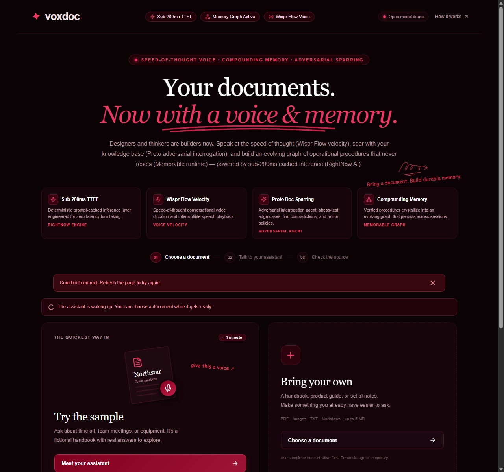

# VoxDoc

<p align="left">
  <a href="https://huggingface.co/spaces/Aravindhan11/VoxDoc"></a>
  <a href="https://github.com/Aravindh-dev12/Voxdoc/actions"></a>
  
  
</p>

**The Voice-Native Interrogation Agent & Compounding Memory Runtime.**

Knowledge workers are no longer passive readers—they are directors. Yet our knowledge tools are still static documents designed for paper in 1993, and traditional AI agents reset into amnesia after every session.

**VoxDoc** unites the frictionless, thought-speed voice flow of **Wispr Flow**, the builder-first direct interrogation agency of **Proto**, and the cumulative procedural memory graph of **Memorable**:
- **Oral Thought-to-Action**: Speak in English, Hindi, or 100+ languages. Zero-latency turn-taking voice powered by Faster-Whisper and Piper TTS.
- **Adversarial Grounding**: Cross-examine contracts, PDFs, and handbooks. Qwen3-4B reasons strictly over verified passages, backed by quote and number verification guards.
- **Compounding Memory Graph**: Rather than renting stateless intelligence that evaporates into logs, every verified answer crystallizes into an evolving procedural knowledge graph (`MemoryNode` & `MemoryEdge`). Future questions compose pre-verified procedures 10x faster.

> 🚀 **Live Demo on Hugging Face:** [https://huggingface.co/spaces/Aravindhan11/VoxDoc](https://huggingface.co/spaces/Aravindhan11/VoxDoc)
> 🌐 **Direct App:** [https://aravindhan11-voxdoc.hf.space](https://aravindhan11-voxdoc.hf.space)

<p align="center">
  
</p>

## See it in one minute

1. Choose **Try the sample**. A fictional company handbook is ready immediately.
2. Click **Start talking**, allow the microphone, and ask: “How many days of paid leave do I get?”
3. Press **Send my question**. The assistant replies aloud and shows the handbook passage: employees receive 24 days each year.

Choose **हिन्दी · Hindi** to ask “मुझे साल में कितने दिन की छुट्टी मिलती है?” You can also type a question or upload a searchable PDF, text file, or Markdown document.

## The Core Vision: Moving Closer to AGI

An answer without a source is hard to trust. A document without a way to ask questions is hard to use. But an AI agent that forgets everything after each turn is fundamentally broken.

VoxDoc bridges these worlds:
1. **Frictionless Voice**: Speaking is 3x faster than typing. Think and direct with your voice.
2. **Deterministic Citations**: Answers must cite exact original excerpts. Hallucinations are actively withheld.
3. **Durable Organizational Ownership**: Experience accumulates instead of disappearing. Every resolved question trains the procedural graph, taking us one step closer to reliable, long-horizon AGI.

## What a visitor can do

- Talk to a document in English or Hindi. Hindi questions are translated into English for retrieval; cited English replies are translated into Hindi.
- Inspect the original source beside each answer. Missing evidence produces an explanation rather than an invented answer.
- Choose automatic sending if you prefer hands-free conversation. Otherwise press **Send my question** after speaking.
- Stop a reply and speak again. Voice is turn-taking: the microphone pauses while the assistant answers.
- Bring a PDF, PNG/JPG/WebP image, text or Markdown document up to 5 MB. Scanned pages use English/Hindi OCR automatically. Ask “What is this document about?” or ask specific questions. Check the imported text and extraction warnings first.
- Open **Explore the engineering** for reference versions, human reviews, the evaluation suite, and system design.

The interface follows three steps: **choose → talk → check**. An English company handbook is the default example; the fictional Aster research fixture remains available for engineering evaluations.

## How it works

```text
microphone → whisper → document search → qwen + source checks → piper → speaker
                              ↓                  ↓
                         source passages    transcript + review trail
```

On upload, pypdf preserves readable PDF text. Image-bearing and unreadable pages are rendered with PDFium and read by Tesseract with English/Hindi language packs. Blank pages are reported; low-confidence scans are rejected before indexing. Extracted text becomes overlapping passages with page references. E5 embeddings are saved in the visitor’s database. Fact questions combine semantic and BM25 search, then a cross encoder reranks the candidates. Overview questions include the full extracted text of short documents; long documents use sampled passages from across the file, with coverage shown in the trace. Qwen selects numbered source excerpts; the server attaches their original text and page references. Invalid source IDs or unsupported numbers withhold the draft. These checks do not prove that every interpretation is correct.

React provides the browser experience. FastAPI owns documents, transcripts, and reviews. A signed visitor token selects a separate SQLite database. Gradio queues model requests on Hugging Face ZeroGPU. Speech runs on CPU with bounded concurrency.

The hosted models are Qwen3-4B-Instruct-2507, faster-whisper small for English and medium for Hindi, NLLB translation, and Piper voices for English and Hindi. There is no paid inference API dependency. Component and voice licenses are documented in [open-source components](docs/open-source.md). The Hindi Pratham voice has a **noncommercial, share-alike dataset license**; this portfolio demo is not a commercially licensed voice service.

## Capacity and honest limits

The target is ten independent visitors using the same demo with queued inference. That is different from ten simultaneous real-time calls. Free GPU quotas, shared CPU resources, and cold starts can cause waits. Visitors should use the canonical Hugging Face page and sign in for their own quota.

Workspaces are temporary and expire after 24 hours; hosting restarts can erase them sooner. Raw audio files are deleted after transcription. Use non-sensitive documents. Hindi pronunciation, transcription, and translation need human verification, and a valid citation does not guarantee a correct interpretation.

Extraction is not perfect for every document. Handwriting, blurry scans, diagrams and complex tables can lose meaning. The demo allows at most 100 PDF pages, 20 OCR pages per upload, 12 megapixels per image and a bounded processing time. OCR confidence screens obvious failures; it is not a guarantee that names or numbers are correct. Password-protected PDFs and other file formats need a text/PDF export. English documents remain the best-tested voice path.

See [verification results](docs/verification.md) for measured checks and their scope, and [deployment](docs/deployment.md) for the queue and session boundaries.

## ⚡ High-Speed Inference with RightNow AI (BYOK)

VoxDoc natively integrates with [RightNow AI](https://www.rightnowai.co/) for ultra-low latency, custom GPU kernel-optimized open-weight inference with **automatic prompt caching**. 

Bring your own API key to bypass shared queues and achieve sub-200ms conversational turn latency:

```powershell
# Option A: Set environment variable
$env:RIGHTNOW_API_KEY = "rn_live_..."

# Option B: Pass your key on startup
voxdoc serve --api-key "rn_live_..." --provider rightnow
```

## 📦 Install & Run via CLI

Install and run VoxDoc as a command-line tool or local server:

```powershell
# 1. Install VoxDoc
pip install -e .

# 2. Interrogate a document from your terminal
voxdoc ask handbook.pdf "How many vacation days do I get?"

# 3. Inspect the compounding organizational memory graph
voxdoc memory

# 4. Launch the full API and web application
voxdoc serve --port 8000
```

## Run locally (Development)

Use Python 3.12 and Node.js. The default local mode returns document excerpts without downloading a language model.

```powershell
python -m venv .venv
.venv\Scripts\python -m pip install -r requirements.lock.txt
.venv\Scripts\python -m pip install -e . --no-deps
.venv\Scripts\python -m uvicorn evidra.api:app --app-dir backend --host 127.0.0.1 --port 8000
```

In another terminal:

```powershell
cd frontend
npm ci
npm run dev
```

Open http://127.0.0.1:5173. For local language-model and voice setup, see [development](docs/development.md). Hindi model answers require Transformers mode; local evidence mode does not translate questions.

## Engineering details

[Manifesto & AGI Vision](docs/manifesto.md) · [System design](docs/system-design.md) · [Decisions](docs/decisions.md) · [Evaluation scope](docs/evaluations.md) · [Deployment](docs/deployment.md) · [Benchmarks](docs/benchmarks.md)

```powershell
.venv\Scripts\python -m pytest
cd frontend
npm run build
```

## 👤 Author & Contact

Developed by **Aravindhan**:
- **GitHub**: [@Aravindh-dev12](https://github.com/Aravindh-dev12)
- **Hugging Face**: [@Aravindhan11](https://huggingface.co/Aravindhan11)
- **Live Demo Space**: [https://huggingface.co/spaces/Aravindhan11/VoxDoc](https://huggingface.co/spaces/Aravindhan11/VoxDoc)
- **Email**: [aravindh1653@gmail.com](mailto:aravindh1653@gmail.com)

---

### License

This project is open-source under the MIT License. See [open-source components](docs/open-source.md) for model weight and dataset notices.
